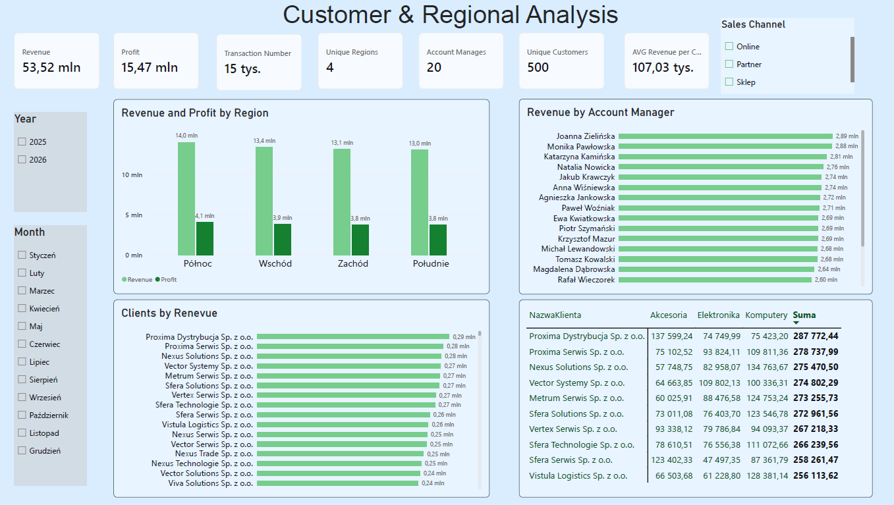

## <h1 align="center">Project Continuation</h1>

This repository contains the data analysis phase of the PowerQuery project. Data cleaning and preparation were completed in a separate repository during the previous stage.

🔗 Previous stage: [POWERQUERY-DATA-CLEANING](https://github.com/asiawaldoch/POWERQUERY-DATA-CLEANING)

## Technologies: Power Query, Power BI, DAX, Data Modeling

<h1 align="center">Project Overview</h1>
This project presents a sales performance analysis developed in Power BI using a dataset containing transactional, customer, product, sales channel, and geographical information.
The report was built on a star schema data model and includes multiple analytical perspectives, covering:

##	Sales Performance Overview
  
<p align="center">
  
</p>

##	Product Performance Analysis

<p align="center">
  
</p>

##	Customer and Regional Analysis

<p align="center">
  
</p>

The objective of the project was to identify key revenue drivers, analyse customer behaviour, evaluate sales channels, and provide actionable business recommendations based on the findings.

<h1 align="center">Dataset Overview</h1>


| Table | Number of Records |
|---------|---------:|
| Sales | ~15,000 | 
| Customers | 500 | 
| Products | 30 | 
| Geography | 4 | 

<h1 align="center">Data Model</h1>

The report was built using a star schema data model.

**Fact Table**

"sprzedaż" - transactional sales data containing quantities, prices, discounts, channels, customers, products, and transaction information.

**Dimension Tables**

"produkty" - product information including categories, subcategories, brands, and base prices

"klienci" - customer details, segments, account managers and geographical assignments

"geografia" - regional structure and regional managers

"kanały" - sales channels and channel types

"kalendarz" - date dimension enabling time-series analysis.

<p align="center">
  
</p>

<h1 align="center">Key DAX Measures</h1>

The report includes custom DAX measures used to evaluate sales performance and business profitability.

<p align="center">
  
</p>

Here are examples of some of them:

**Revenue**
```DAX
Revenue = 
SUMX(sprzedaz,
sprzedaz[Ilosc] *
sprzedaz[CenaJednostkowa] *
(1 - sprzedaz[Rabat])
)
```
**Cost**
```DAX
Cost = 
sumx(sprzedaz,
sprzedaz[Ilosc] *
sprzedaz[KosztJednostkowy]
)
```
**Margin %**
```DAX
Margin % = 
DIVIDE(
    [Profit],
    [Revenue]
)
```
**Average Revenue per Customer**
```DAX
AVG Revenue per Customer = 
divide(
    [Revenue],
    [Unique Customers]
)
```

<h1 align="center">Business Problem</h1>

The company has experienced steady sales growth over the last two years; however, management lacks a clear understanding of the factors driving revenue, profitability, and customer behaviour. Several business challenges have been identified:

- **Limited Visibility Into Revenue Drivers**
The company does not fully understand which product categories, sub-categories, and sales channels contribute most to revenue and profit generation.
- **High Order Cancellation Rates**
Approximately half of all completed transactions are matched by cancelled orders across product categories. The business lacks insight into the root causes of these cancellations and their impact on revenue.
- **Inefficient Customer Portfolio Management**
Management lacks a clear understanding of how customer portfolios influence Account Manager performance and whether revenue differences result from individual effectiveness or account allocation.
- **Seasonal Revenue Fluctuations**
Revenue varies throughout the year, with recurring declines observed in February and changing revenue peaks across different periods. The company needs better insight into seasonal demand patterns to support planning and forecasting.
- **Limited Understanding of Regional Performance**
Although sales are distributed across multiple regions, management requires deeper insight into regional performance differences and potential growth opportunities

<h1 align="center">Business Questions</h1>

1. Which product categories generate the highest revenue and profit?
2. How does revenue change throughout the year, and can any seasonal sales patterns be identified?
3. Which sales channels generate the highest revenue and profit, and where should future investments be focused?
4. Which product sub-categories are the main drivers of revenue and profitability?
5. Which product categories have the highest cancellation rates, and what factors may contribute to these cancellations?
6. Who are the company's key customers, and which product categories receive the largest share of their spending?
7. Which Account Managers generate the highest revenue, and to what extent is their performance influenced by the customer portfolios they manage?

   

