## <h1 align="center">Project Continuation</h1>

This repository contains the data analysis phase of the PowerQuery project. Data cleaning and preparation were completed in a separate repository during the previous stage.

🔗 Previous stage: [SALES-ANALYTICS-01-POWERQUERY](https://github.com/asiawaldoch/SALES-ANALYTICS-01-POWERQUERY)

## Technologies: Power Query, Power BI, DAX, Data Modeling

<h1 align="center">Project Overview</h1>
This project presents a sales performance analysis developed in Power BI using a dataset containing transactional, customer, product, sales channel, and geographical information.
The report was built on a star schema data model and includes multiple analytical perspectives, covering:

##	Sales Performance Overview

<p align="center">
  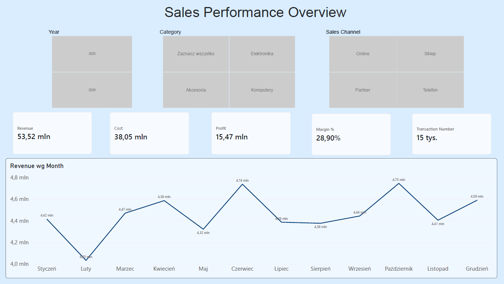
</p>

##	Product Performance Analysis

<p align="center">
  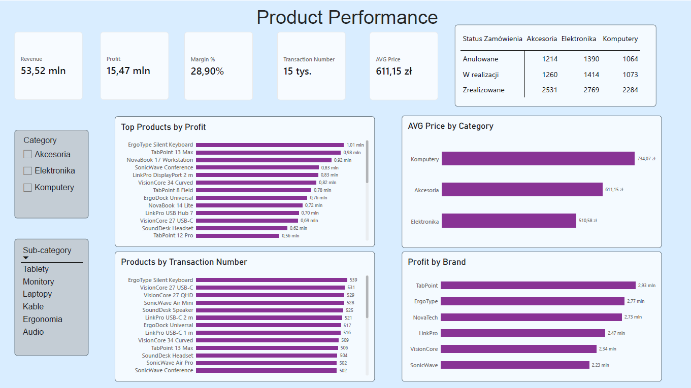
</p>

##	Customer and Regional Analysis

<p align="center">
  
</p>

The objective of the project was to identify key revenue drivers, analyse customer behaviour, evaluate sales channels, and provide actionable business recommendations based on the findings.

<h1 align="center">Dataset Overview</h1>


| Table | Number of Records |
|---------|---------:|
| Sales | ~15,000 | 
| Customers | 500 | 
| Products | 30 | 
| Geography | 4 | 

<h1 align="center">Data Model</h1>

The report was built using a star schema data model.

**Fact Table**

"sprzedaż" - transactional sales data containing quantities, prices, discounts, channels, customers, products, and transaction information.

**Dimension Tables**

"produkty" - product information including categories, subcategories, brands, and base prices

"klienci" - customer details, segments, account managers and geographical assignments

"geografia" - regional structure and regional managers

"kanały" - sales channels and channel types

"kalendarz" - date dimension enabling time-series analysis.

<p align="center">
  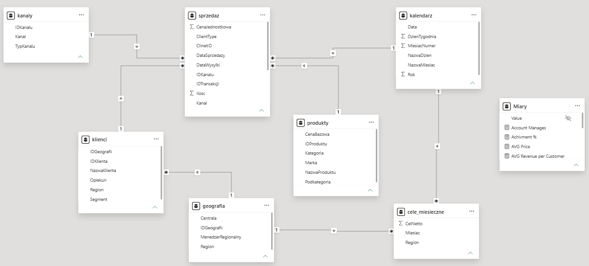
</p>

<h1 align="center">Key DAX Measures</h1>

The report includes custom DAX measures used to evaluate sales performance and business profitability.

<p align="center">
  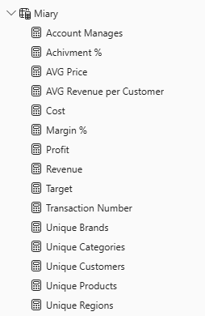
</p>

Here are examples of some of them:

**Revenue**
```DAX
Revenue = 
SUMX(sprzedaz,
sprzedaz[Ilosc] *
sprzedaz[CenaJednostkowa] *
(1 - sprzedaz[Rabat])
)
```
**Cost**
```DAX
Cost = 
sumx(sprzedaz,
sprzedaz[Ilosc] *
sprzedaz[KosztJednostkowy]
)
```
**Margin %**
```DAX
Margin % = 
DIVIDE(
    [Profit],
    [Revenue]
)
```
**Average Revenue per Customer**
```DAX
AVG Revenue per Customer = 
divide(
    [Revenue],
    [Unique Customers]
)
```

<h1 align="center">Business Problem</h1>

The company has experienced steady sales growth over the last two years; however, management lacks a clear understanding of the factors driving revenue, profitability, and customer behaviour. Several business challenges have been identified:

- **Limited Visibility Into Revenue Drivers**
The company does not fully understand which product categories, sub-categories, and sales channels contribute most to revenue and profit generation.
- **High Order Cancellation Rates**
Approximately half of all completed transactions are matched by cancelled orders across product categories. The business lacks insight into the root causes of these cancellations and their impact on revenue.
- **Inefficient Customer Portfolio Management**
Management lacks a clear understanding of how customer portfolios influence Account Manager performance and whether revenue differences result from individual effectiveness or account allocation.
- **Seasonal Revenue Fluctuations**
Revenue varies throughout the year, with recurring declines observed in February and changing revenue peaks across different periods. The company needs better insight into seasonal demand patterns to support planning and forecasting.
- **Limited Understanding of Regional Performance**
Although sales are distributed across multiple regions, management requires deeper insight into regional performance differences and potential growth opportunities

<h1 align="center">Business Questions</h1>

1. Which product categories generate the highest revenue and profit?
2. How does revenue change throughout the year, and can any seasonal sales patterns be identified?
3. Which sales channels generate the highest revenue and profit, and where should future investments be focused?
4. Which product sub-categories are the main drivers of revenue and profitability?
5. Which product categories have the highest cancellation rates, and what factors may contribute to these cancellations?
6. Who are the company's key customers, and which product categories receive the largest share of their spending?
7. Which Account Managers generate the highest revenue, and to what extent is their performance influenced by the customer portfolios they manage?

## <h1 align="center">ANALYSIS</h1>
   
## Question 1: Which categories generate the highest revenue and profit?

<p align="center">
  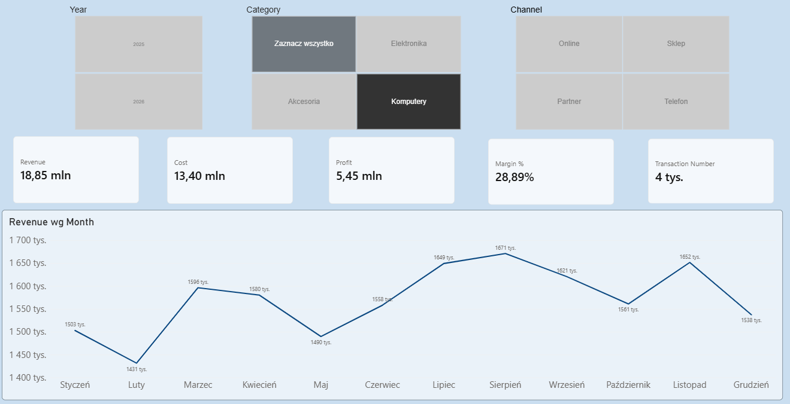
</p>

## Observation
Category “Komputery” generated the highest revenue (18,85M) and profit (5,45M) despite recording the lowest number of transactions (approximately 4K). This may indicate a higher average order value compared to the other product categories.

“Elektronika” category generated the lowest revenue (16.65M) and profit (4,78M). However, revenue and profit remain relatively balanced across all categories, suggesting that the business is not heavily dependent on a single product segment.

Additional analysis revealed that the Online sales channel generated the highest revenue across all product categories.

## Recommendiation

“Komputery”  category represents the strongest-performing product segment, generating both the highest revenue and the highest profit. Given its strong financial performance, additional investment in marketing activities and product visibility could further increase revenue and profitability.

The relatively low transaction volume combined with high revenue suggests that customers purchasing products from this category tend to place higher-value orders. This creates an opportunity to focus promotional campaigns, product positioning, and customer acquisition efforts on this segment.

Although the category “Elektronika” generated the lowest revenue and profit, it should not be considered for reduction or removal. The category recorded the highest transaction volume (approximately 6K transactions), indicating strong customer demand and consistent engagement. As a result, "Elektronika" continues to play an important role in attracting customers and generating additional revenue.

To maintain sustainable growth, the company should continue supporting all product categories while prioritizing strategic investments in the category "Komputery", where the potential return appears to be the highest

## Question 2: How does sales performance change from month to month?

<p align="center">
  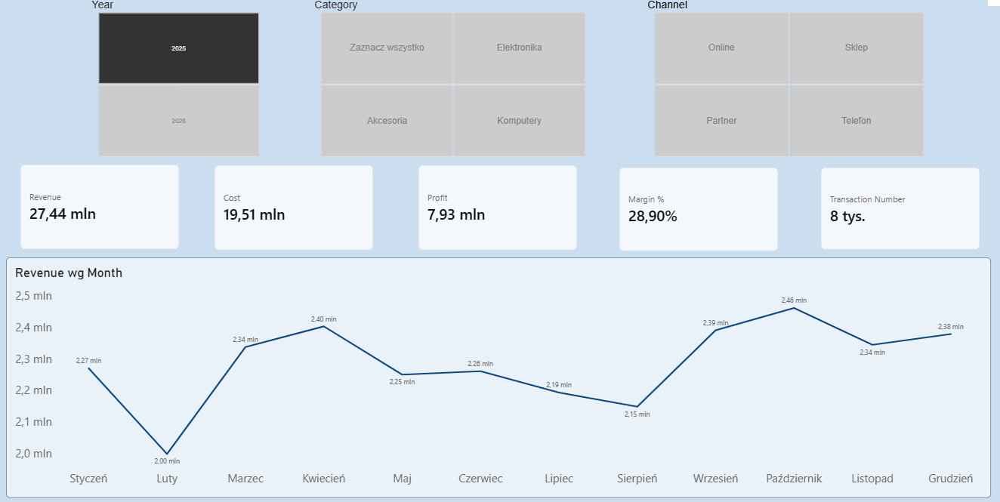
</p>

<p align="center">
  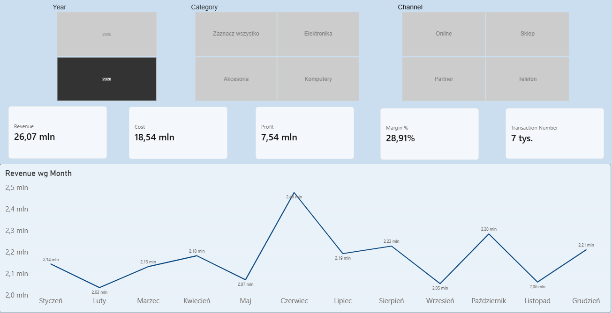
</p>

## Observation

In 2025, revenue peaked in October (2,46M), followed by April (2,40M) and December (2,38M). The lowest revenue was recorded in February (2,0M).
In 2026, the highest revenue was achieved in June (2,48M), followed by October (2,28M) and August (2,23M). Similar to the previous year, February (2,03M) generated the lowest revenue.

The analysis indicates that revenue fluctuates throughout the year rather than following a completely stable pattern. While peak months differ between years, February consistently records the weakest performance, suggesting a recurring seasonal slowdown.

Another notable finding is that revenue did not increase significantly during November, despite the period typically being associated with Black Friday promotions. This may indicate that promotional activities were either limited or less effective than expected.

## Recommendiation

The business should ensure adequate inventory levels, operational readiness, and customer service capacity during historically strong sales periods, particularly during the second half of the year when revenue tends to increase.

Since February delivered the lowest revenue in both analysed years, the company should consider initiatives aimed at stimulating demand during this period. Potential actions may include targeted marketing campaigns, seasonal promotions, loyalty program incentives, or limited-time offers designed to encourage customer purchases.

Additionally, the relatively moderate performance observed in November suggests an opportunity to review Black Friday and pre-holiday promotional strategies. Further analysis should be conducted to evaluate campaign effectiveness and identify opportunities for increasing customer engagement during this key retail period.

## Question 3: Which Sales Channel Generates the Highest Revenue?

<p align="center">
  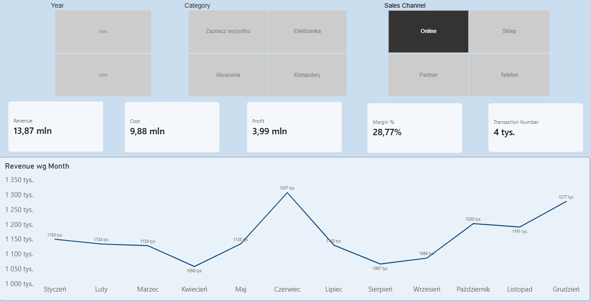
</p>

## Observation

"Online" channel generated the highest revenue (13,87M), along with a profit of 3,99M and a profit margin of 28,77%, Revenue peaked in June (1,31M) and December (1,28M), indicating stronger performance during these periods.

"Partner" channel ranked second, generating approximately 13,7M in revenue, Revenue performance varied significantly throughout the year, suggesting less predictable month-to-month sales patterns compared to other channels.

"Sklep" channel generated the lowest revenue (12,94M), Despite ranking last among the four sales channels, the difference in revenue compared to the other channels remains relatively small, indicating a balanced revenue distribution across channels.

## Recommendiation

"Online" channel is currently the strongest sales channel and should remain a strategic priority for the business. Since online sales continue to generate the highest revenue, further investment in digital capabilities could lead to additional growth opportunities.

To support future growth, the company should focus on improving the customer experience by ensuring a user-friendly website, clear product navigation, seamless checkout processes, and high-quality product information. Additional revenue opportunities could also be generated through personalized product recommendations, cross-selling initiatives, and targeted online marketing campaigns.

Although "Sklep" channel generates the lowest revenue, it should not automatically be considered underperforming. Further analysis should be conducted to determine whether individual stores differ significantly in performance. Identifying top-performing and low-performing locations would allow the company to replicate successful practices while addressing operational challenges in weaker stores.

Finally, "Partner" channel should be monitored more closely due to its irregular sales pattern. Additional investigation may help identify external factors influencing revenue fluctuations and reveal opportunities to improve channel stability and forecasting accuracy.

## Question 4: Which Sub-category generates the highest revenue?

<p align="center">
  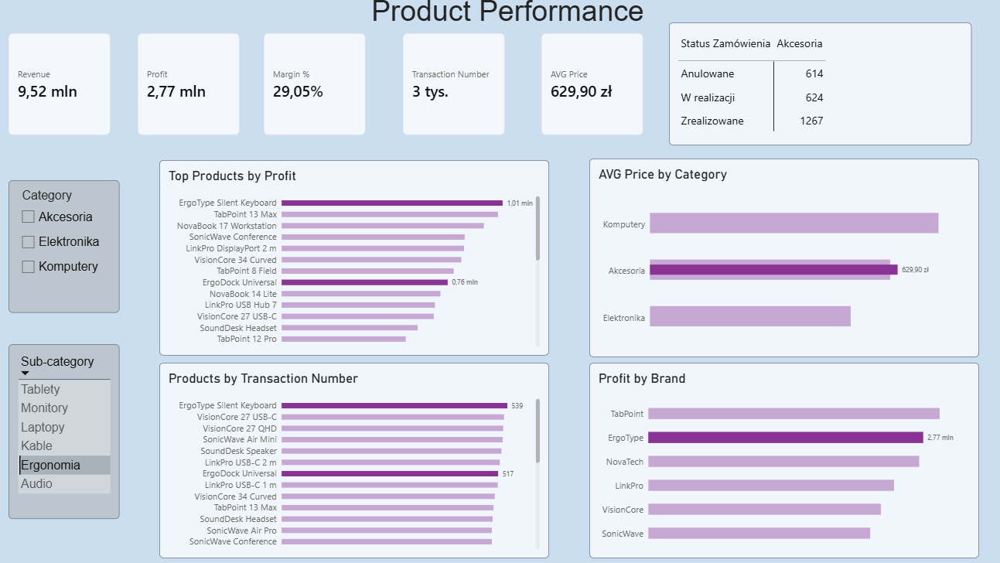
</p>

<p align="center">
  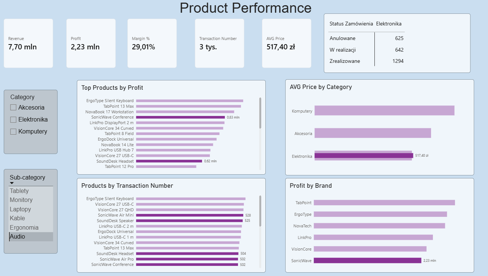
</p>

## Observation

The highest revenue was generated by the “Ergonomia” sub-category (9,52M), closely followed by “Monitory” (9,51M). These results indicate that revenue is distributed across multiple product areas rather than being concentrated in a single sub-category.

The strong performance of Ergonomics confirms that the “Akcesoria” category plays an important role in overall business performance. In addition, the product “ErgoType Silent Keyboard” generated the highest profit among all products (1,01M) and recorded the highest transaction volume, indicating strong and consistent customer demand.

“Audio” sub-category generated the lowest revenue among the analysed sub-categories. It is also associated with the lowest average selling price, which may contribute to its lower revenue performance.

## Recommendiation

The company should continue investing in the “Ergonomia” sub-category, as it currently generates the highest revenue and includes one of the strongest-performing products in the portfolio. Expanding the product range, increasing stock availability, and supporting the category through targeted marketing campaigns may create additional growth opportunities.

“Monitory” sub-category should also remain a strategic focus area. Its revenue performance is almost identical to Ergonomics, indicating strong customer demand and significant growth potential. Product portfolio expansion and continued promotional support could further strengthen results

Although "Audio" sub-category generates the lowest revenue, its transaction volume remains comparable to other sub-categories. This suggests that lower revenue is driven primarily by lower average selling prices rather than weak customer demand.

Therefore, "Audio" should be treated as a complementary product segment rather than an underperforming one. The company should maintain its presence in this category while exploring opportunities to increase profitability through product bundles, premium product variants, and cross-selling initiatives.

## Question 5: Which Product Categories Have the Highest Cancellation Rate?

<p align="center">
  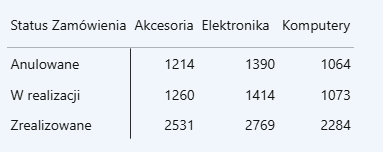
</p>

## Observation

“Elektronika” category recorded the highest cancellation rate, with cancelled transactions representing approximately 50,20% of completed transactions. At the same time, Electronics also achieved the highest number of completed orders, indicating a high level of customer activity within this category.

“Komputery” category achieved the lowest cancellation rate (46,58%), while also recording the lowest number of completed transactions among the analysed categories.

Overall, cancellation rates remain relatively similar across all categories, ranging from approximately 46% to 50%. This suggests that the issue may not be limited to a single product category but could be related to broader operational or customer-experience factors. The root cause may be related to company-wide processes rather than category-specific issues.

## Recommendiation

The cancellation rate appears relatively high across all categories and should be investigated further. The company should analyse potential causes, including product availability, delivery times, pricing, order processing issues, and customer expectations.
To better understand customer behaviour, the company could implement a short post-cancellation survey to collect feedback from customers who decide not to complete their purchases. This would provide valuable insights into the most common reasons for order cancellations.
Additionally, analysing customer segments, products, and sales channels with the highest cancellation rates could help identify patterns and support targeted improvement initiatives. Reducing cancellations would not only increase realised revenue but also improve operational efficiency and customer satisfaction.

## Question 6: In Which Region Do Stores Generate the Highest Revenue and Profit?

<p align="center">
  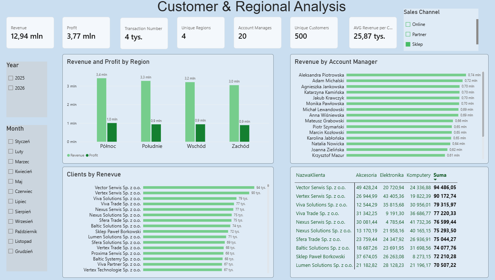
</p>

## Observation

The North (Północ) region generated the highest revenue (3,4M) and profit (1,0M) among all analysed regions.
The West (Zachód) region recorded the lowest revenue (3,0M) and profit (0,9M). However, the difference between the highest- and lowest-performing regions remains relatively small, indicating a balanced geographical distribution of sales performance.

Overall, revenue and profit levels appear consistent across all regions, suggesting that no single region dominates the company's performance.

## Recommendiation

Although the “Zachód” region generated the lowest revenue and profit, the performance gap compared to the other regions is not significant enough to justify major strategic changes. Instead, the company should conduct further analysis to identify factors that may be limiting performance in this region.

A more detailed review of individual store locations, customer behaviour, product demand, and local market conditions could help explain the lower results. Gathering feedback from store managers and employees may also provide valuable operational insights.

The “Północ” region should be used as a benchmark for best practices. Understanding what drives its stronger performance may help identify successful strategies that could be implemented in other regions.
Given the relatively balanced performance across all regions, the company's objective should be to improve underperforming areas while maintaining strong results in the higher-performing regions.

## Question 7: Which Clients Are Most Important for the Company?

<p align="center">
  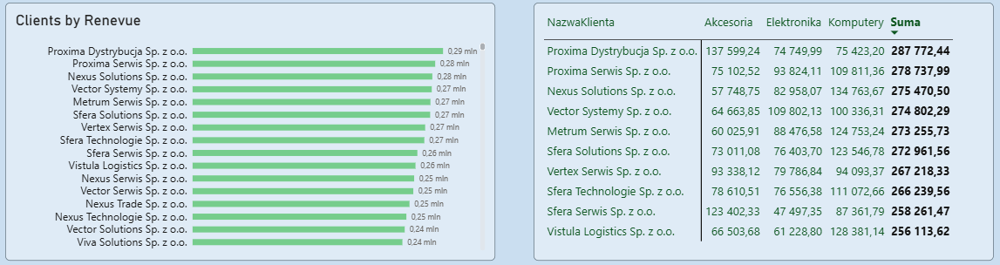
</p>

## Observation

The company's largest customers, based on revenue generation, are Proxima Dystrybucja Sp. z o.o., Proxima Serwis Sp. z o.o., and Nexus Solutions Sp. z o.o.

The revenue distribution among the top customers appears relatively balanced, with the leading customer generating approximately 0,29M in revenue. This suggests that the company is not overly dependent on a single client and benefits from a diversified customer portfolio.

The analysis also indicates that customer rankings may change over time. In 2026, companies such as Vistula Logistics Sp. z o.o. and Proxima Logistics Sp. z o.o. became increasingly important contributors to revenue, highlighting opportunities for customer portfolio growth.

Further analysis of purchasing patterns reveals that key customers have different product preferences. While the “Komputery” category represents the largest spending area for several major customers, including Nexus Solutions Sp. z o.o., Vector System Sp. z o.o., and Vistula Logistics Sp. z o.o., other customers focus their spending on different product categories.

For example, Proxima Dystrybucja Sp. z o.o., the company's highest-revenue customer, generates most of its revenue through the “Akcesoria” category, spending significantly more on this category than others. This indicates a distinct purchasing profile compared to several other top customers.

These findings suggest that the company serves diverse customer needs and is not dependent on a single product category across its key customer accounts.

## Recommendiation

The highest-revenue customers should be treated as key accounts and receive dedicated relationship management. Maintaining strong relationships with these customers is essential, as customer retention is often more cost-effective than acquiring new clients.

The company should analyse purchasing behaviour, preferred product categories, and buying patterns among its top customers. Understanding what drives demand within these accounts may help identify opportunities for cross-selling and upselling additional products and services.

Because top customers demonstrate different purchasing preferences, the company should develop customer-specific sales strategies rather than applying a uniform approach to all key accounts. For example, customers with a strong focus on “Komputery” could be offered complementary “Akcesoria”, while customers purchasing mainly “Akcesoria” may represent opportunities for expansion into other product categories.

Regular customer satisfaction monitoring and proactive communication should be implemented to strengthen long-term partnerships. Special attention should be given to customers whose revenue contribution is increasing, as they may represent future strategic accounts.

## Question 8: Which Account Managers Generate the Highest Revenue?

<p align="center">
  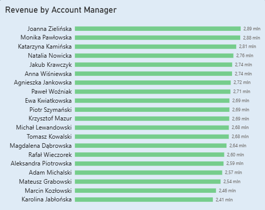
</p>

<p align="center">
  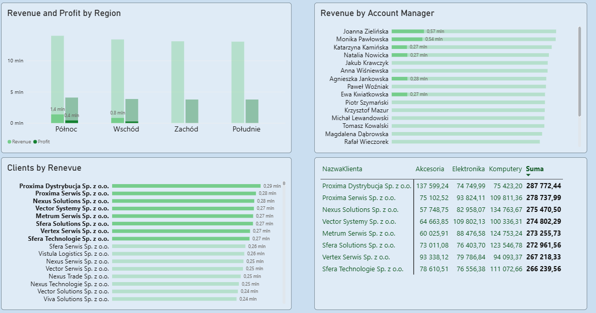
</p>

## Observation

The highest-performing Account Managers were Joanna Zielińska (2,89M), Monika Pawłowska (2,88M), and Katarzyna Kamińska (2,81M), all generating more than 2,8M in revenue.

At the lower end of the ranking, Karolina Jabłońska (2,41M), Marcin Kozłowski (2,46M), and Mateusz Grabowski (2,54M) generated the lowest revenue among the analysed Account Managers.
Despite these differences, revenue performance across Account Managers remains relatively balanced. The gap between the highest and lowest performers is less than 0,5M, suggesting a fairly even distribution of customer portfolios and sales results.

The analysis also indicates that revenue performance is not determined solely by region. While the North region generated the highest overall revenue, not all Account Managers assigned to this region achieved the strongest individual results. This suggests that customer portfolio composition and account management practices may play an important role in overall performance.

## Recommendiation

The company should recognise and reward high-performing Account Managers to encourage employee engagement and motivation. Sharing successful sales practices and customer management strategies may help improve overall team performance.
Regular performance reviews and knowledge-sharing sessions should be introduced to identify factors contributing to strong sales results. Understanding the approaches used by top-performing Account Managers may help replicate success across the organisation.

For Account Managers generating lower revenue, additional analysis should be conducted before any conclusions are drawn. The company should review the size and structure of their customer portfolios, customer purchasing behaviour, and account assignments to identify potential areas for improvement. 

Furthermore, the analysis suggests that some of the highest-performing Account Managers are responsible for several of the company's largest customers. This may partially explain their stronger revenue performance and indicates that results are influenced not only by individual performance but also by the value and composition of assigned customer portfolios.
Finally, management should focus on providing ongoing support, coaching, and development opportunities to ensure that all Account Managers have the resources required to maximise customer value and contribute to long-term revenue growth.

## <h1 align="center">Project Continuation</h1>

The analysis identified several important factors:

1. "Komputery" category emerged as the strongest-performing product category, generating the highest revenue (18,85M) and profit (5,45M). Despite having the lowest number of transactions, the category achieved the best financial results, suggesting higher average order values.
2. "Ergonomia" and "Monitory" sub-category proved to be the most important sub-categories, generating the highest revenue among all analysed product groups. These areas represent significant growth opportunities for future product development and marketing activities.
3. "Online" channel was the most effective sales channel, producing the highest revenue and profit. The findings suggest that continued investment in digital sales capabilities may deliver additional growth.
4. Revenue demonstrated seasonal fluctuations, with February consistently recording the lowest performance in both analysed years. This indicates a recurring seasonal slowdown that may require targeted promotional activities.
5. Cancellation rates remained high across all product categories, ranging from approximately 46% to 50% of completed transactions. Since the pattern is visible across all categories, the root cause may be related to broader operational or customer-experience issues rather than individual products.
6. The company benefits from a diversified customer portfolio, with no single customer representing a disproportionate share of total revenue. At the same time, purchasing behaviour differs significantly among key customers, highlighting the importance of personalised account management.
7. Regional performance remains relatively balanced, with only minor differences between regions. While the "Północ" region achieved the strongest results, no region substantially outperformed or underperformed the others.
8. Revenue differences between Account Managers were relatively small, suggesting a balanced distribution of customer portfolios. The analysis also indicates that access to larger customer accounts may partially explain the performance of the highest-performing Account Managers.

## <h1 align="center">Key Conclusions</h1>

The company should prioritize investments in high-performing product segments, particularly "Komputery" category and "Ergonomia" and "Monitory" sub-categories. At the same time, management should focus on understanding the causes of high cancellation rates, as this appears to be one of the most significant operational challenges identified during the analysis.

Further investigation should be conducted into the performance of stores located in the West region to determine whether operational, market, or customer-related factors are limiting growth. The company should also continue developing its online sales channel while implementing more personalized strategies for key customer accounts and Account Managers.

Overall, the analysis indicates that the business operates on a stable and diversified foundation, with opportunities for growth concentrated in product portfolio optimization, online sales development, customer relationship management, and operational efficiency improvements.


